# Secure-Homelab

Self-hosted Cloud-Homelab mit Security-Fokus – Praxisprojekt für Cloud Security Engineering

> 🚧 **Work in Progress** – dieses Projekt entsteht aktuell, README wird laufend aktualisiert

## Tech-Stack

## Architektur

Ein Ubuntu-Server im Heimnetz betreibt einen k3s-Cluster. Der Router hat keine Portfreigabe, der Zugriff von außen läuft ausschließlich über das Tailnet (Tailscale, WireGuard). Tailscale Serve terminiert TLS auf dem Host mit einem Zertifikat für den .ts.net-Namen und gibt genau einen Endpunkt frei: /metrics. Alles andere ist nur auf der Node selbst erreichbar, per SSH und curl oder über kubectl port-forward.

Im Cluster laufen zwei Workloads. Ein gehärteter nginx-Container als Testaufbau und ein selbst geschriebener Monitoring-Agent auf Basis von FastAPI, der CPU-, RAM- und Disk-Werte des Servers ausliest und über eine API-Key-geschützte API bereitstellt. Beide Services sind vom Typ ClusterIP und damit aus dem Heimnetz nicht direkt ansprechbar. Der Code des Agents liegt im separaten Repo [https://github.com/headnutAi/homelab_monitor].

Zusätzlich zur Abschottung nach außen ist der Verkehr innerhalb des Clusters eingeschränkt: Eine NetworkPolicy regelt für nginx sowohl eingehende als auch ausgehende Verbindungen. Der Egress-Teil ist dabei der wichtigere, denn er begrenzt, wohin ein kompromittierter Pod überhaupt Verbindungen aufbauen könnte.

```mermaid
flowchart LR
    client["Client<br/>Browser im Tailnet"]

    subgraph home["Heimnetz &#40;keine Portfreigabe im Router&#41;"]
        subgraph host["Ubuntu-Server"]
            ts["tailscaled + Serve<br/>TLS, nur /metrics"]
            ssh["SSH-Session<br/>auf der Node"]

            subgraph k3s["k3s-Cluster"]
                subgraph np["NetworkPolicy: Ingress + Egress"]
                    nginx["nginx &#40;Test&#41;<br/>ClusterIP"]
                end
                mon["monitor-agent<br/>FastAPI &#124; ClusterIP<br/>&#40;keine Policy&#41;"]
            end

            ts -->|"/metrics"| mon
            ssh -.->|"curl, nur lokal"| nginx
        end
    end

    client -->|"HTTPS via WireGuard"| ts
    client -.->|"SSH via Tailscale"| ssh
```

## Motivation

Dieses Projekt entsteht, um Cloud- und Security-Konzepte praktisch zu üben, statt sie nur in Tutorials zu lesen – mit dem Ziel, mich für eine Rolle in diesem Bereich vorzubereiten.

## Was wurde umgesetzt

### Infrastruktur
- [x] Ubuntu Server (headless) auf dem PC installiert, inkl. OpenSSH
- [x] System aktuell gehalten (apt update/upgrade, ggf. unattended-upgrades)
- [x] SSH gehärtet: nur Public-Key-Login, Passwort-Login deaktiviert, Root-Login gesperrt
- [x] Firewall (ufw) mit minimal nötigen offenen Ports
- [x] fail2ban gegen Brute-Force-Versuche eingerichtet

### Container & Sicherheit
- [x] Docker installiert
- [x] Container laufen nicht als root (unprivilegiertes Image + securityContext)
- [x] Images vor dem Start mit Trivy gescannt
- [x] k3s-Cluster installiert
- [x] ServiceAccount-Token für Pods ohne API-Bedarf deaktiviert
- [x] NetworkPolicies zwischen Pods eingerichtet

### Infrastructure as Code
- [x] Terraform installiert
- [x] Docker-Provider für Terraform eingerichtet
- [x] main.tf mit provider/docker_image/docker_container geschrieben
- [x] Secrets/Variablen in .tfvars ausgelagert statt im Code
- [x] .tfstate und .tfvars in .gitignore eingetragen

### Netzwerk & Zugriff
- [x] Tailscale auf dem Server installiert und verbunden
- [x] Tailscale auf Endgeräten (Laptop/Handy) eingerichtet
- [x] ACLs in der Tailscale-Admin-Konsole konfiguriert

### CI / Security-Scanning
- [x] GitHub Actions Workflow für das Repo eingerichtet
- [x] terraform fmt -check und terraform validate bei jedem Push
- [x] tfsec oder Checkov zur Prüfung der Terraform-Konfiguration
- [x] Trivy als Action für automatisierte Image-Scans
- [x] Gitleaks zur Erkennung versehentlich committeter Secrets

### Eigener Monitoring-Agent (homelab-monitor)

Ein selbst geschriebener Metrik-Collector (FastAPI), der als Pod im k3s-Cluster läuft und ausschließlich über das Tailnet erreichbar ist. Quellcode: [homelab-monitor](https://github.com/headnutAi/homelab_monitor)

- [x] Collector als Deployment im Cluster, mit demselben securityContext wie der nginx-Pod
- [x] API-Key-Authentifizierung über `X-API-Key`, Vergleich mit `secrets.compare_digest`
- [x] API-Key als Kubernetes Secret, per `secretKeyRef` als Umgebungsvariable in den Pod
- [x] OpenAPI-Schema und Swagger-UI in Produktion deaktiviert, per Umgebungsvariable zuschaltbar
- [x] Service von NodePort auf ClusterIP umgestellt, kein offener Port mehr im Heimnetz
- [x] Zugriff über `tailscale serve` mit gültigem Let's-Encrypt-Zertifikat auf dem `.ts.net`-Namen
- [x] Tailscale-ACL um den Serve-Port erweitert, NodePort per ACL-Test ausgeschlossen
- [ ] NetworkPolicy für den Monitor-Pod (Ingress + Egress), analog zum nginx-Pod

## Security-Entscheidungen

| Entscheidung | Begründung |
|---|---|
| Firewall (ufw): Default-Deny incoming, einzige Regel ist 22/tcp | Jeder offene Port ist Angriffsfläche. Am LAN-Interface wird alles andere verworfen, nicht abgelehnt, was Port-Scans langsam und unergiebig macht. Der Monitor auf 443 braucht hier keine Regel, weil sein Listener an tailscale0 gebunden ist und das LAN-Interface gar nicht erreicht. Der Monitor auf 443 braucht hier keine Regel, weil er nur im Tailnet lauscht (siehe tailscale serve). |
| fail2ban aktiv | Sperrt IPs nach wiederholten fehlgeschlagenen Login-Versuchen und unterbindet so Brute-Force-Angriffe. |
| Tailscale statt Portfreigabe im Router | Verschlüsselte Peer-to-Peer-Verbindung (WireGuard) zwischen den Geräten. Der Server ist aus dem öffentlichen Internet nicht erreichbar. |
| SSH nur mit Public-Key, Passwort-Login deaktiviert | Keys lassen sich nicht per Brute-Force erraten.  |
| Root-Login gesperrt | root existiert auf jedem System und ist ein bekanntes Angriffsziel. Admin-Aktionen laufen über sudo und bleiben nachvollziehbar. |
| Tailscale-ACLs statt Standard-Freigabe | Standardmäßig darf im Tailnet jedes Gerät jedes andere auf allen Ports erreichen. Die ACL erlaubt nur Zugriff auf tag:server, dort Port 22 für SSH und 443 für den Monitor über tailscale serve (Least Privilege). Diese Freigaben gelten innerhalb des Tailnets und sind unabhängig von den ufw-Regeln, die den Zugriff am LAN-Interface regeln. |
| Automatisierte ACL-Tests | Jede Policy-Änderung wird beim Speichern gegen definierte Erwartungen geprüft – verhindert versehentliche Fehlkonfiguration. |
| Device Approval aktiviert | Neue Geräte müssen manuell freigegeben werden. Zweite Kontrollebene, falls der Account kompromittiert wird. |
| Tailscale SSH bewusst nicht aktiviert | Authentifizierung bleibt bei den eigenen SSH-Keys, statt sie an einen Drittanbieter abzugeben. |
| Kein User in der docker-Gruppe | Gruppenmitglieder können über Container das Host-Dateisystem mounten und so root-Rechte erlangen – ohne sudo-Protokollierung. Docker wird bewusst nur über sudo genutzt. |
| Alpine-basierte Images statt Debian-Standard | Vergleichsscan mit Trivy: nginx:latest (145 Pakete) zeigt 390 bekannte Schwachstellen, nginx:alpine (71 Pakete) nur 2. Weniger installierte Software bedeutet weniger Angriffsfläche. |
| Images vor dem Einsatz mit Trivy gescannt | Jeder Container erbt alle Schwachstellen seines Images. Ein Scan zeigte auch Lücken mit Status fixed – Images veralten still, auch wenn der Tag gleich bleibt. |
| nginxinc/nginx-unprivileged statt Standard-nginx | Der Standard-nginx läuft als root im Container. Wird eine Lücke ausgenutzt, hat der Angreifer sofort root-Rechte und ist einem Container-Ausbruch deutlich näher. |
| Schreibgeschütztes Container-Dateisystem (read_only bei Docker, readOnlyRootFilesystem bei Kubernetes) | Verhindert, dass Schadcode im Container abgelegt wird. Nur die Pfade, die nginx tatsächlich braucht, sind beschreibbar – und liegen im RAM, sind also nach einem Neustart weg. |
| no-new-privileges:true | Prozesse können über SetUID-Binaries keine zusätzlichen Rechte erlangen. Begrenzt den Schaden bei einer Kompromittierung. |
| Variablen in variables.tf / terraform.tfvars ausgelagert | Konfiguration vom Code getrennt. Bei Secrets bewusst ohne default, damit ein vergessener Wert nicht still durch einen Standardwert ersetzt wird. |
| securityContext mit runAsNonRoot, allowPrivilegeEscalation: false und capabilities: drop ALL| Mehrere unabhängige Schutzebenen: Der Container läuft nicht als root, kann keine Dateien ablegen, keine Rechte über SetUID erlangen und hat keine der standardmäßig vergebenen Linux-Capabilities. Jede Ebene unterbricht einen anderen Schritt einer Angriffskette. |
| NetworkPolicy mit Default-Deny und gezielter Freigabe | Standardmäßig darf jeder Pod jeden erreichen. Zugriff jetzt nur noch für Pods mit passendem Label. |
| automountServiceAccountToken: false | nginx braucht die Kubernetes-API nicht. Ohne Token findet ein kompromittierter Container keinen Clusterzugang. |
| Egress-Regel, nur DNS erlaubt | Verhindert Nachladen von Schadcode, Datenabfluss und Ausbreitung im Cluster, falls der Container kompromittiert wird. |
| seccomp-Profil RuntimeDefault auf Pod-Ebene für nginx und Monitor | Ohne Angabe läuft ein Container mit dem vollen Syscall-Satz des Kernels. RuntimeDefault nutzt das Profil der Container-Runtime, auf Pod-Ebene gesetzt, damit spätere Container erben. Gilt nur für eigene Manifeste; die k3s-Systempods laufen noch ohne. Geprüft am 25.10.2026 gegen das containerd-Default-Profil (crictl inspect): Default-Aktion ist SCMP_ACT_ERRNO, die Modul-Syscalls (init_module, finit_module, delete_module) sowie mount, pivot_root und kexec_load fehlen in der Allowlist und sind damit blockiert.|
| tfsec in der CI-Pipeline | Findet unsichere Terraform-Konfigurationen im Pull Request statt in der Produktion (Shift Left). |
| Täglicher Trivy-Scan, CRITICAL bricht die Pipeline ab | Images veralten still, auch wenn der Tag gleich bleibt. Kritische Funde erzwingen eine Reaktion, hohe werden nur berichtet, da sie bei fremden Images meist nicht selbst behebbar sind. |
| Gitleaks scannt die gesamte Git-Historie | Ein committetes Secret bleibt über den Commit-Hash abrufbar, auch nach dem Löschen der Datei. .gitignore allein schützt nur vor neuen Commits. |
| Monitor über ClusterIP + `tailscale serve` statt NodePort | NodePort lauscht auf allen Interfaces des Nodes und ist damit für jedes Gerät im Heimnetz erreichbar, auch für Gäste und IoT. ClusterIP nimmt den Dienst aus dem LAN, der Zugriff läuft über denselben Weg wie SSH. |
| API-Key zusätzlich zur Netzwerkbeschränkung | Zwei unabhängige Ebenen: Wer nicht im Tailnet ist, kommt nicht an den Dienst. Wer im Tailnet ist, braucht trotzdem einen Schlüssel. Ein kompromittiertes Gerät im Tailnet hat damit nicht automatisch Zugriff auf alles. |
| OpenAPI-Schema und Swagger-UI in Produktion deaktiviert | Das Schema nennt jeden Endpoint, die erwartete Authentifizierungsmethode und den Header-Namen. Das ist eine Bauanleitung für Angreifer und kostet nichts, sie wegzulassen. Default ist "aus", die Docs müssen aktiv eingeschaltet werden. |
| `secrets.compare_digest` statt `==` beim Key-Vergleich | Ein normaler String-Vergleich bricht beim ersten falschen Zeichen ab, die Antwortzeit verrät damit, wie viele Zeichen stimmen. `compare_digest` braucht immer gleich lange. Im Heimnetz kaum ausnutzbar, aber der richtige Reflex. |
| API-Key als Kubernetes Secret, nicht als Datei im Image | Ein Key im Image liegt in jeder Kopie davon und ist über `docker history` auslesbar. Als Secret lässt er sich rotieren, ohne das Image neu zu bauen. Secrets sind dabei nur base64-kodiert, nicht verschlüsselt – der Gewinn liegt in Trennung und Rotierbarkeit, nicht in Kryptografie. |
| `tailscale serve` statt `funnel` | serve macht den Dienst nur im eigenen Tailnet erreichbar, funnel würde ihn ins öffentliche Internet stellen. Die Befehle sehen fast gleich aus, der Unterschied ist erheblich. serve bindet den Listener dabei ausschließlich an das Tailnet-Interface, der Dienst existiert auf dem LAN-Interface gar nicht (geprüft mit ss -tlnp). Preis: Die Bindung ist eine Eigenschaft von Tailscale, nicht eigene Konfiguration, und kann sich mit einer neuen Version ändern. |
| Mitgelieferten Ingress-Controller (Traefik) deaktiviert | k3s installiert Traefik standardmäßig mit, ohne dass man ihn anfordert. Ohne ein einziges Ingress-Objekt belegte er Port 80 und 443 auf allen Interfaces und war damit aus dem Heimnetz erreichbar. Deaktiviert per `--disable=traefik`, weil der Zugriff über Tailscale läuft. Ein ungenutzter Dienst ist Angriffsfläche plus Patch-Aufwand ohne Gegenwert, die installierte Version war bereits zwei Releases hinterher. |
| kubelet (10250) und k3s-API (6443) lauschen auf allen Interfaces, werden aber von ufw am LAN-Interface verworfen | Geprüft am 25.10.2026 von einem LAN-Gerät: beide laufen ins Timeout, Port 22 antwortet als Positivkontrolle. Die UFW-Logs belegen den DROP auf enp3s0. Anders als bei Docker umgeht k3s die ufw-Regeln hier nicht. Preis: Der Schutz hängt allein an der Paketfilterung, der offene Listener bleibt bestehen. Eine Bindung an tailscale0 wie beim Monitor wäre die zweite Ebene und ist offen. |
| Third-Party-Actions auf vollen Commit-SHA gepinnt, Version als Kommentar dahinter | Tags sind verschiebbar, Major-Tags wie @v4 wandern bei jedem Release ohnehin weiter. Ein SHA ist unveränderlich, damit läuft nachweislich derselbe Code wie beim letzten Lauf. Grenze: Der SHA friert den Code ein, prüft ihn aber nicht. |
| Dependabot für github-actions und pip, wöchentlich, mit 5 Tagen Cooldown | Gepinnte Versionen veralten still, deshalb der Gegenpart zum SHA-Pinning. Dependabot öffnet pro Update einen PR statt still zu aktualisieren: Die Änderung ist sichtbar, die CI testet sie vorher, und der Merge bleibt eine bewusste Entscheidung. Der Cooldown lässt frische Releases reifen, weil fehlerhafte oder kompromittierte Versionen meist innerhalb weniger Tage auffallen. |
| Secrets-Verschlüsselung im Datastore aktiviert (secrets-encryption: true, AES-CBC) | Ohne sie liegen Kubernetes-Secrets lediglich base64-kodiert im Datastore, also im Klartext für jeden, der an die Datei kommt. Aktiviert am 27.10.2026 auf k3s v1.36.5+k3s1, bestehende Secrets anschließend per secrets-encrypt rotate-keys neu verschlüsselt. Grenze: Der Schlüssel liegt unverschlüsselt in server/cred/ auf demselben Host. Geschützt ist damit ein gestohlenes Laufwerk, eine abgezogene Kopie der state.db oder ein unverschlüsseltes Backup, nicht der Zugriff über die API oder durch root. Preis: Ein Backup des Datastores ist ohne den passenden Schlüssel nicht mehr wiederherstellbar, beides muss gesichert werden. |
| Server-Flags in /etc/rancher/k3s/config.yaml statt in der systemd-Unit | Die Unit wird vom k3s-Installer geschrieben und bei einem Upgrade überschrieben, eigene Änderungen können dabei still verschwinden. Die config.yaml wird nicht angefasst, ist YAML und damit versionierbar. Preis: Konfiguration liegt vorübergehend an zwei Orten, solange --disable=traefik noch in der Unit steht. CLI-Argumente haben dabei Vorrang vor der Datei. |

## Lessons Learned

Docker umgeht die Firewall
Ein veröffentlichter Container-Port war trotz ufw mit Default-Deny aus dem gesamten Heimnetz erreichbar. Docker schreibt eigene iptables-Regeln, die vor den ufw-Regeln greifen. Gefunden nur, weil in den nginx-Logs ein Zugriff von einer lokalen IP auftauchte, die dort nicht hätte stehen dürfen. Gelöst durch Bindung des Ports an das Tailscale-Interface statt an 0.0.0.0.

cloud-init überschreibt die SSH-Konfiguration
Die Härtung in /etc/ssh/sshd_config blieb wirkungslos, weil eine Datei in sshd_config.d/ sie übersteuerte. Eigene 99-hardening.conf angelegt – höhere Nummer gewinnt. Lehre: Nach jeder Änderung mit sshd -T prüfen, was tatsächlich gilt, statt der Konfigurationsdatei zu vertrauen.

Härtung ist iterativ, nicht deklarativ
read_only = true hat den Container beim ersten Versuch gekillt. Man muss erst herausfinden, wohin eine Anwendung tatsächlich schreibt – Logs lesen, Pfad ergänzen, wiederholen. Dasselbe beim Wechsel auf das unprivilegierte Image, plus der Grund dahinter: Prozesse ohne root dürfen keine Ports unter 1024 belegen.

Basis-Image-Wahl ist eine Security-Entscheidung
Trivy-Vergleich: 390 Schwachstellen bei nginx:latest gegen 2 bei nginx:alpine. Derselbe Webserver. Außerdem: Ein Treffer hatte Status fixed – Images veralten still, auch wenn der Tag gleich bleibt.

Hardware zuerst ausschließen
Die Installation hing an einer defekten Festplatte, nicht an einem Konfigurationsfehler. dmesg zeigte BadCRC und ICRC ABRT, also Übertragungsfehler auf SATA-Ebene. Vorher waren zwei Stunden in Rufus-Einstellungen und BIOS-Optionen geflossen.

Ressourcen planen, bevor man installiert
Das BIOS gibt nur 2,7 von 8 GB RAM frei, dazu reserviert der Kernel 320 MB für ungenutzte Crash-Dumps. Trivy scheiterte zudem an /tmp, das im RAM liegt und nur 1,4 GB groß ist. In Kubernetes zwingt das zu Ressourcenlimits – was man ohnehin tun sollte, hier aber nicht freiwillig lernt.

Zugriffskontrolle kostet Bequemlichkeit
Jeder neue Dienst braucht eine bewusste Freigabe: in ufw, in der Tailscale-ACL, in der NetworkPolicy. Das fühlt sich zunächst umständlich an und ist genau der Punkt – wer alles offen lässt, erspart sich die Entscheidung und verliert die Kontrolle.

Egress ist der vergessene Teil der Segmentierung
Ingress schreiben fast alle, Egress kaum jemand. Dabei ist das die Richtung, die Datenabfluss und Ausbreitung nach einem Einbruch verhindert. Stolperstein: Blockiert man alles, scheitert schon die Namensauflösung – und der Fehler sieht nach einem Verbindungsproblem aus.

NodePort ist ein Entwicklungswerkzeug, kein Betriebsmodus Der Collector war über 192.168.1.8:31111 aus dem gesamten Heimnetz erreichbar, weil NodePort beim Entwickeln der schnellste Weg war, um zu sehen ob der Dienst antwortet. Danach blieb er stehen. Dasselbe Muster wie bei der Docker-Portfreigabe weiter oben, nur eine Ebene höher. In Cloud-Umgebungen ist das die Security Group mit 0.0.0.0/0, die "nur kurz zum Debuggen" entstand. Der Unterschied zwischen einem funktionierenden und einem sicheren Setup ist meistens nicht Wissen, sondern Aufräumen.

Authentifizierung ersetzt keine Netzwerkbeschränkung Der Dienst gab auf /metrics korrekt "not authenticated" zurück, war aber trotzdem zu offen: /docs, /redoc und /openapi.json lieferten ohne jede Prüfung das komplette API-Schema inklusive Header-Namen der Authentifizierung. Dazu lief alles über HTTP, der Key wäre also im WLAN mitlesbar gewesen. Gefunden durch systematisches Abklappern der üblichen Pfade statt durch Vertrauen in den einen geprüften Endpoint.

Der Server erreicht sich selbst nicht über seinen Tailscale-Namen Vom Handy funktionierte der Zugriff, vom Server selbst nicht. Ursache: k3s bedient LoadBalancer-Services über svclb-Pods, die Port 80 und 443 per DNAT-Regel abfangen, nicht über einen sichtbaren Listener. Solche Regeln greifen auch für lokal erzeugte Pakete an die Tailscale-Adresse. Traffic von Peers läuft dagegen durch den WireGuard-Tunnel und wird von tailscaled im Userspace direkt zugestellt, also an der Regel vorbei. Kein Fehler im Setup, aber ein Verhalten, das man einmal verstanden haben muss, sonst sucht man an der falschen Stelle.

Secrets landen in der Shell-History Ein curl -H "X-API-Key: ..." steht danach in ~/.bash_history. Konsequenz: Keys über Umgebungsvariablen übergeben, und Befehle mit Geheimnissen mit einem führenden Leerzeichen eingeben, damit sie je nach HISTCONTROL gar nicht erst aufgezeichnet werden.

k3s bringt Traefik als Ingress-Controller mit. Er lief seit der Installation, belegte Port 80 und 443 auf allen Interfaces und hatte nichts zu tun, weil nie ein Ingress-Objekt angelegt wurde. Aufgefallen erst bei einer Bestandsaufnahme mit `ss -tlnp` statt `ufw status`. Dasselbe Muster wie bei Docker weiter oben: Die eigene Konfiguration sieht sauber aus, die tatsächlich offenen Ports stehen woanders. Die ehrliche Antwort auf "was ist offen" liefert nicht die Firewall-Konfiguration, sondern die Liste der lauschenden Sockets, und der Gegentest von einem anderen Gerät aus.

Ein Image im containerd-Namespace default existiert für k3s nicht – ctr image import legt ohne -n k8s.io im falschen Namespace ab. k3s sucht ausschließlich in k8s.io, findet nichts und fällt auf die Registry zurück. Die Fehlermeldung zeigt dann auf docker.io/library/<name> und klingt nach einem Berechtigungsproblem bei Docker Hub, obwohl das Image lokal längst vorliegt. Gegenprobe ist crictl images: Was dort nicht auftaucht, kann k3s nicht starten.

Encryption Status: Enabled heißt nicht, dass die vorhandenen Secrets verschlüsselt sind. Der Schalter wirkt nur auf neue Schreibvorgänge. Die Zeile, auf die es ankommt, ist Current Rotation Stage: Solange dort start steht, wurde kein bestehender Eintrag angefasst. Erst rotate-keys schreibt sie neu und bringt die Stufe auf reencrypt_finished.

Eine neue Revision ersetzt die alte nicht sofort. kine legt Objektstände als eigene Zeilen ab. Nach der Neuverschlüsselung stand das Secret zweimal im Datastore, einmal verschlüsselt und einmal im Klartext. Dieselbe Struktur wie bei einem committeten Secret in der Git-History: Der aktuelle Stand ist sauber, der alte bleibt abrufbar. Wirksam dagegen ist nur die Rotation des Secrets selbst, nicht das Löschen von Kopien.

## Screenshots

Trivy Sicherheitsscan von dem nginx image mit der alpine

---

Unterschied zwischen debian und alpine 

Vergleich der Basis-Images: nginx:latest (Debian, 145 Pakete) → 390 bekannte Schwachstellen. nginx:alpine (71 Pakete) → 2. Gleicher Webserver, deutlich kleinere Angriffsfläche.

---

Nachweis, dass das Container-Dateisystem schreibgeschützt ist

---

Neben dem eigenen nginx-service ist der cluster-interne kubernetes-Service zu sehen, über den die API erreichbar ist. Beide vom Typ ClusterIP, also nur innerhalb des Clusters ansprechbar.

---

Legt die gewünschte Anzahl an Pods fest (replicas: 1) und enthält sämtliche Härtungsmaßnahmen: nicht-root-Benutzer, keine Privilege Escalation und das Entfernen aller Linux-Capabilities.

---

Pod-IPs ändern sich bei jedem Neustart. Der Service bietet deshalb einen festen Namen, über den die Pods clusterintern erreichbar bleiben, und leitet Port 80 auf den Container-Port 8080 weiter.

---

Standardmäßig wird jedem Pod ein Token für die Kubernetes-API ins Dateisystem gelegt. Da nginx die API nicht benötigt, wurde das Einhängen deaktiviert – ein kompromittierter Container findet damit keinen Zugang zum Cluster.

Vorher:

Nachher:

---

In Kubernetes darf standardmäßig jeder Pod jeden anderen erreichen. Die Policy kehrt das um: Eingehender Verkehr ist blockiert, erlaubt sind nur Pods mit dem Label role: client auf Port 8080.

Beide Anfragen sind identisch und unterscheiden sich nur im Label des aufrufenden Pods. Ohne role: client wird die Verbindung abgewiesen, mit Label kommt sie durch. Die Policy greift also wie vorgesehen für alle Pods mit app: frontend.

Die Meldung lautet “Connection refused” und nicht wie erwartet ein Timeout. Grund: Der in k3s mitgelieferte NetworkPolicy-Controller lehnt per REJECT mit icmp-port-unreachable ab, statt Pakete still zu verwerfen.

Mit Label role: client – Anfrage geht durch:

---

Die Worker-Prozesse starten sauber, obwohl das Root-Dateisystem read-only ist. Beschreibbar ist nur /tmp, eingebunden als emptyDir im RAM.

Der Versuch, eine Datei im Container anzulegen, scheitert. Damit kann auch ein Angreifer keinen Schadcode ablegen.

Dieselbe Abfrage vor und nach secrets-encrypt rotate-keys. Einer liegt im Klartext obwohl die Verschlüsselung schon aktiviert war. Der andere lag dann nur noch Verschlüsselt vor.

---

**Kontakt:** Demian W. · [github.com/headnutAi](https://github.com/headnutAi)
